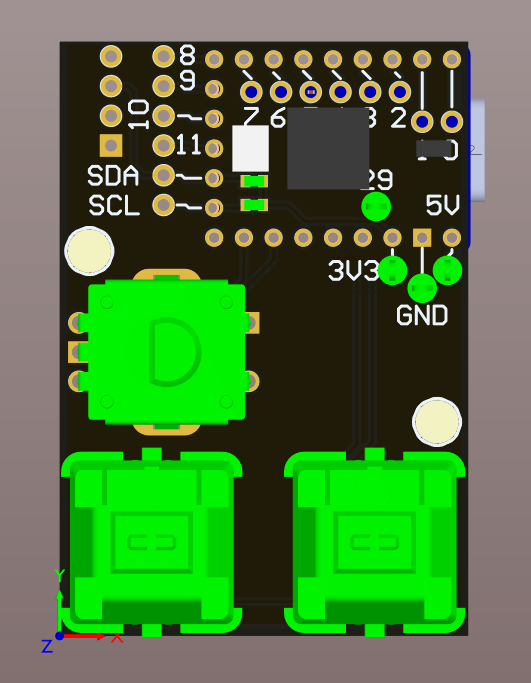
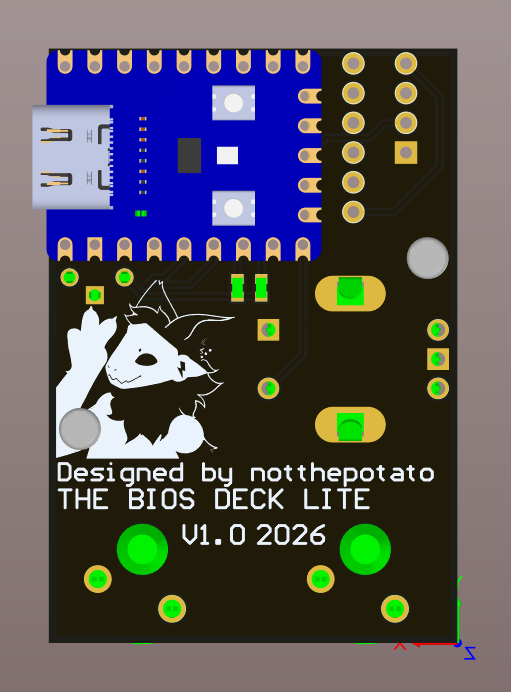

# THE BIOS Deck

A tiny USB macro pad that gets you into the BIOS for you. Pick the motherboard brand, plug it in, reboot. The Deck taps the right setup key through the whole boot screen so you never miss the window again.

<p align="center">
  
  &nbsp;&nbsp;
  
</p>

<p align="center"><b>Current hardware: BIOS Deck Lite v1.0 (2026)</b></p>

---

## Why

Every manufacturer uses a different key to enter setup (Del, F2, F1, F10, Esc…), and with fast boot you get maybe a second to hit it. If you work on a lot of different machines, guessing the key and mashing it at the right moment gets old fast. The BIOS Deck remembers the keys so you don't have to.

## How it works

1. Plug the Deck into a USB port on the target PC.
2. Turn the knob to pick the brand on the OLED, then press the knob to select it.
3. Restart (or power on) the PC.

The Deck shows up as a normal USB keyboard and keeps sending that brand's setup key while the PC boots, so you land straight in the BIOS.

<!-- TODO: describe what the two key switches (BTN_0 / BTN_1) do in the firmware -->

### Typical BIOS keys by brand

<!-- TODO: keep this table in sync with the brand list in the firmware -->

| Brand | Setup key |
|---|---|
| ASUS | `Del` (desktop boards), `F2` (laptops) |
| MSI | `Del` |
| Gigabyte / AORUS | `Del` |
| ASRock | `F2` or `Del` |
| Dell | `F2` |
| HP | `Esc` then `F10` |
| Lenovo | `F1` (ThinkPad / ThinkCentre), `F2` (IdeaPad) |
| Acer | `F2` (`Del` on some desktops) |

## Hardware

- **MCU:** Waveshare RP2040-Zero. Its USB-C port connects to the target PC and powers the whole board.
- **Display:** 0.91″ I²C OLED module
- **Input:** Bourns PEC12R rotary encoder with push switch, plus two Cherry MX key switches
- **Expansion:** GP0–GP11 and the I²C bus broken out on 2-pin headers
- **Test points:** 5V, 3V3, GND and GP29
- Designed in Altium Designer

### Pinout

| RP2040-Zero pin | Net | Connected to |
|---|---|---|
| GP0, GP1 | — | JP7 |
| GP2, GP3 | — | JP6 |
| GP4, GP5 | — | JP5 |
| GP6, GP7 | — | JP1 |
| GP8, GP9 | — | JP2 |
| GP10, GP11 | IO10, IO11 | JP4 |
| GP12 | SDA (I2C0) | OLED, JP3 · 1 kΩ pull-up to 3V3 |
| GP13 | SCL (I2C0) | OLED, JP3 · 1 kΩ pull-up to 3V3 |
| GP14 | ENC_SWT | Encoder push switch (active low) |
| GP15 | ENC_CLK | Encoder channel A · 10 kΩ pull-up to 3V3 |
| GP26 | ENC_DT | Encoder channel B · 10 kΩ pull-up to 3V3 |
| GP27 | BTN_0 | Key switch S4 (active low) |
| GP28 | BTN_1 | Key switch S5 (active low) |
| GP29 | — | Test point TP4 |
| 5V | 5V | OLED VIN, TP2 |
| 3V3 | 3V3 | Pull-ups, TP1 |

**Firmware notes**

- The encoder switch and both key switches pull to GND and have **no external pull-ups**, so enable the internal pull-ups on GP14, GP27 and GP28.
- The encoder A/B lines already have 10 kΩ pull-ups on the board.
- The RP2040-Zero's own RGB LED (GP16) isn't used by the board and is free for status.

### Bill of materials

| Ref | Part | Qty | Notes |
|---|---|---|---|
| U1 | Waveshare RP2040-Zero | 1 | |
| S3 | Bourns PEC12R-4230F-S0024 | 1 | Rotary encoder with push switch, takes a 6 mm D-shaft knob |
| S4, S5 | Cherry MX1A-11NN | 2 | Any MX-style switch fits |
| Q1 | 0.91″ I²C OLED module, 4-pin | 1 | |
| R1, R2 | 1 kΩ resistor | 2 | I²C pull-ups |
| R3, R4 | 10 kΩ resistor | 2 | Encoder pull-ups |
| JP1–JP7 | 1×2 pin header | 7 | Optional, for expansion |
| TP1–TP4 | Keystone 5003 test point | 4 | Optional |
| — | Knob + 2 MX keycaps | — | |

## Flashing firmware

<!-- TODO: link the firmware source / .uf2 release here -->

The RP2040-Zero uses the standard UF2 bootloader:

1. Hold the **BOOT** button on the RP2040-Zero while plugging it into your computer (or hold BOOT and tap RESET).
2. It shows up as a USB drive called `RPI-RP2`.
3. Drag the `.uf2` file onto the drive. The board reboots and runs the new firmware.

## Repo layout

```
├── BIOS-DECK-LITE/        Lite board files
├── Schematic/
│   └── BIOS Deck Lite.pdf   Full schematic
├── Layer views/           Top/bottom copper and designator PDFs
└── docs/                  Top and bottom renders
```

## Credits

Designed by **notthepotato**.

<!-- TODO: add a license -->
